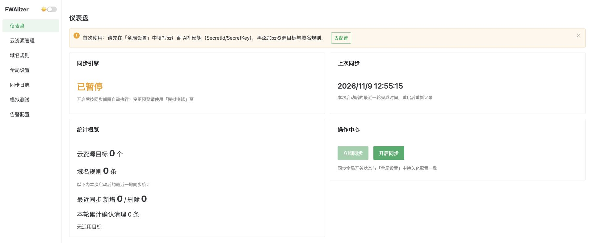
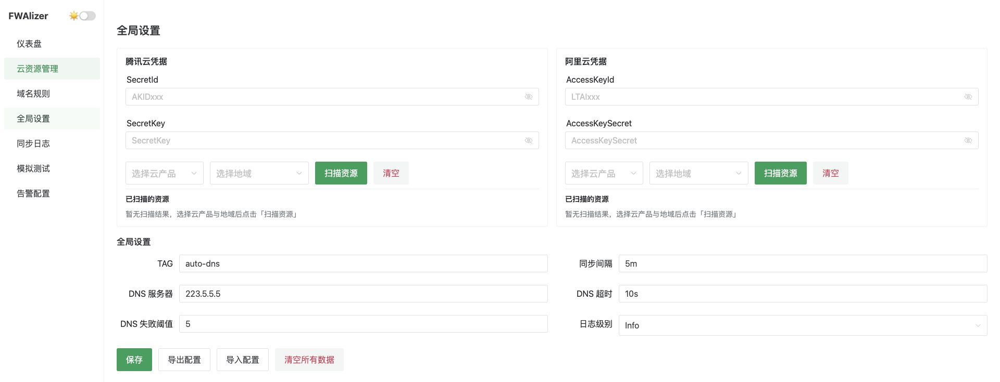
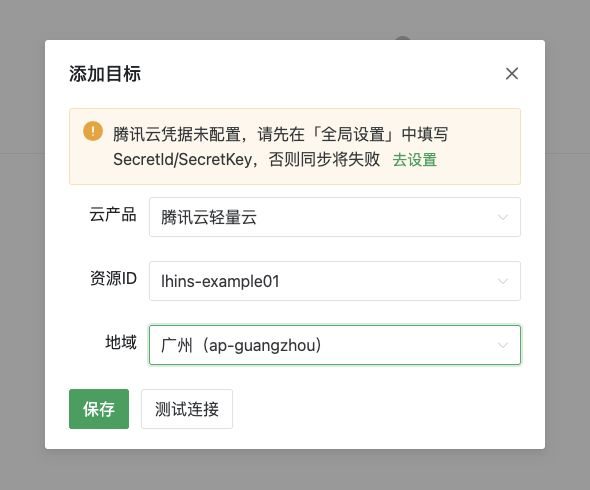
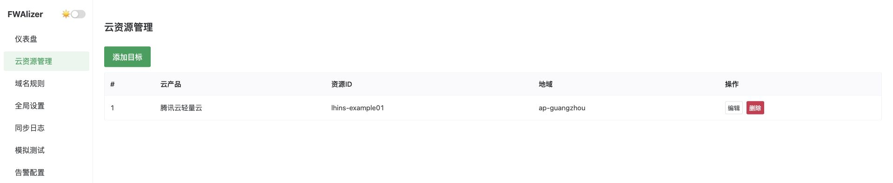
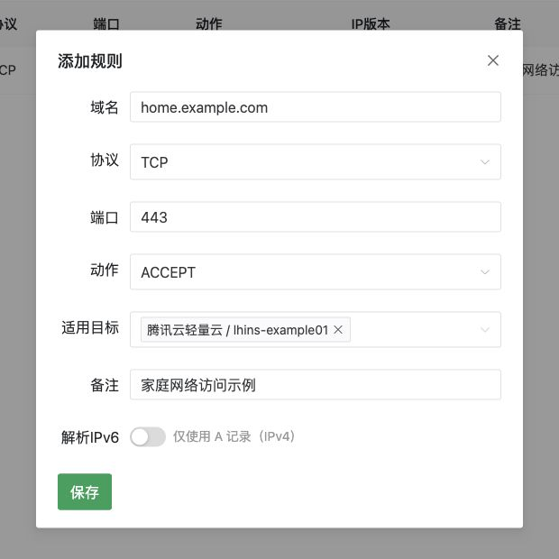
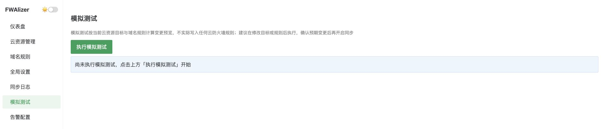
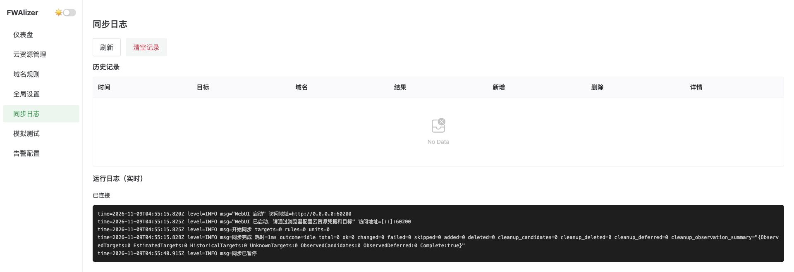
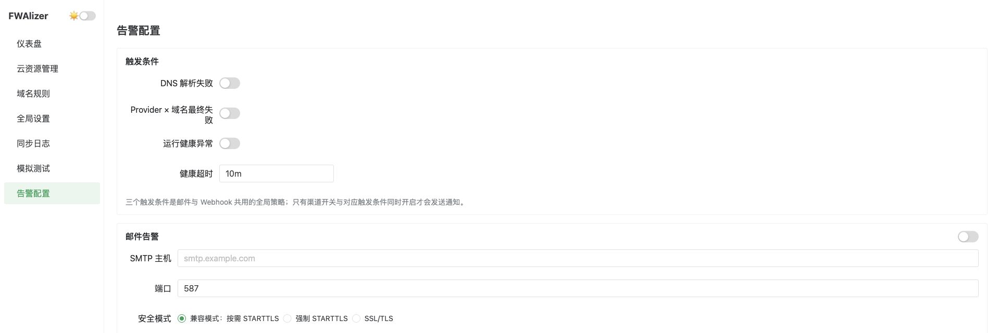

# FWAlizer · 让云防火墙白名单跟随域名 IP

家里的公网 IP 变了，原来的云防火墙白名单就可能失效。把家里网络的 DDNS 域名交给 FWAlizer，它会定时查询域名，把查到的 IP 同步到指定的云防火墙或安全组。比如，只允许 `home.example.com` 当前指向的 IP 访问一台云服务器的 TCP `443` 端口。

支持 **腾讯云轻量云、腾讯云 CVM、阿里云轻量云（SWAS）、阿里云 ECS**。用浏览器配置即可，数据保存在本地 SQLite 中。首次安装推荐 **Docker Compose**。

[Docker 安装](#用-docker-compose-安装) · [第一次配置](#第一次配置) · [备份和升级](#日常维护) · [常见问题](#常见问题)

## 用 Docker Compose 安装

准备一台已安装 Docker 和 Compose 的主机。发布镜像为 `linux/amd64`，ARM 主机需要启用 amd64 仿真。先运行 `docker compose version`，确认 Compose 可用。 [发布镜像](https://github.com/AlcaProphet/cloudhost-firewall-autoupdater/pkgs/container/fwalizer)

### 1. 下载并启动

在 **运行 Docker 的主机** 上打开终端。将 [Compose 示例](docker-compose.yml.example) 保存到一个新目录，命名为 `docker-compose.yml`。也可以用下面的命令下载。

```bash
mkdir fwalizer
cd fwalizer
curl -fL https://raw.githubusercontent.com/AlcaProphet/cloudhost-firewall-autoupdater/main/docker-compose.yml.example \
  -o docker-compose.yml
```

示例使用 `ghcr.io/alcaprophet/fwalizer:3.0.2`，并用 `fwalizer_data` 命名卷保存数据。已有部署时，请在原目录编辑现有文件。

```bash
docker compose config --quiet && docker compose pull && docker compose up -d
docker compose ps
```

### 2. 打开网页

- **Docker 跑在你的电脑上**，直接打开 [http://127.0.0.1:60200](http://127.0.0.1:60200)。
- **Docker 跑在远程 Linux 服务器上**，在你的电脑上开启下面的 SSH 隧道。把 `user@server` 换成你的 SSH 用户和服务器地址，保持终端打开，再在本机浏览器访问同一地址。

```bash
ssh -N -L 127.0.0.1:60200:127.0.0.1:60200 user@server
```

> WebUI 没有内置登录。Compose 默认只把端口开放给 Docker 宿主机本身。请保留这个默认值，通过 SSH 隧道访问远程实例。

## 第一次配置

截图来自本地 Chrome 中运行的 `3.0.2`，资源 ID 和域名都是示例。开始前准备好一个会随公网 IP 更新的 DDNS 域名、一个测试目标，以及对应云厂商的 API 密钥。

### 1. 暂停同步

新实例默认开启自动同步。进入 **仪表盘 → 操作中心**，点击 **暂停同步**。看到「已暂停」后，再填写凭据、添加目标和规则。



### 2. 保存云厂商密钥

进入 **全局设置**。腾讯云填写 `SecretId` 和 `SecretKey`，阿里云填写 `AccessKeyId` 和 `AccessKeySecret`。只填你要用的厂商，点击页面底部的 **保存**。同步间隔默认 `5m`，TAG 默认 `auto-ddns`，初次使用可以保留。

使用 CAM 或 RAM 子账号，按需授权目标的规则读取、添加和删除操作。若要使用 **扫描资源**，还需授权列出相应地域的实例或安全组。保存密钥后，在凭据卡片中选择云产品和地域即可扫描。 [云平台 API 参考](#云平台-api-参考)



### 3. 添加一个云资源目标

进入 **云资源管理 → 添加目标**。目标是你要更新规则的云资源。轻量云填写 **实例 ID**，CVM 和 ECS 填写 **安全组 ID**。使用扫描结果可自动填入地域，也可以手动填写。安全组关联多台实例时，规则会影响这些实例。

先点 **测试连接**，确认 FWAlizer 能读取该资源的规则，再点击 **保存**。



<details>
<summary>查看目标保存后的列表</summary>



</details>

### 4. 添加一条域名规则

进入 **域名规则 → 添加规则**。域名指的是 **发起访问的一端**。例如，要让家里的设备访问云服务器，就填家里公网 IP 对应的 DDNS 域名。

| 字段 | 示例 | 怎么填 |
| --- | --- | --- |
| 域名 | `home.example.com` | 换成自己的 DDNS 域名，填写域名本身 |
| 协议、端口 | `TCP`、`443` | 填云服务器上要放行的端口 |
| 动作 | `ACCEPT` | 表示允许访问 |
| 适用目标 | 刚添加的轻量云实例 | 明确选中该目标。留空会应用到全部目标 |
| 解析IPv6 | 关闭 | 默认只查询 IPv4 的 A 记录。启用后也查询 AAAA 记录 |

确认后点击 **保存**。端口支持 `443`、`80,443`、`8000-8010` 等写法。`ALL` 表示所选协议的全部端口，按实际需要选择。



### 5. 先模拟，再开启同步

1. 保持暂停，进入 **模拟测试 → 执行模拟测试**。模拟会解析域名、读取云规则并显示预览，云端规则保持原样。
2. 逐个核对目标卡片里的 IP、协议、端口和动作。关注「待新增」及清理候选。如果显示 DNS 错误、冲突或平台无法实施，先处理这些问题。如果显示「无适用规则」，检查上一步选的目标。
3. 预览符合预期后，回到 **仪表盘** 点击 **开启同步**。在 **同步日志** 查看第一轮正式同步结果，再到云控制台核对对应的入站规则。



FWAlizer 先添加缺少的权限，再重新读取云端规则确认权限生效。只有满足安全条件时，它才会清理带当前 TAG 的旧规则。默认 TAG 的匹配格式为 `[auto-ddns]` 或 `[auto-ddns] ` 后接备注。请给 FWAlizer 保留独立 TAG，手动规则使用其他描述。DNS 失败或覆盖确认失败时会保留旧权限。

## 日常维护

### 看同步状态和日志

在 **仪表盘** 看同步开关和最近一轮结果，在 **同步日志** 看历史增删及实时日志。「清理延后」表示所需权限已确认，旧 IP 或端口仍可能保留。删除本地目标也会保留对应的云端规则，如需撤销访问，请到云控制台核对并处理旧规则。



常用容器命令在 Compose 文件所在目录执行。

| 要做什么 | 命令 |
| --- | --- |
| 查看容器状态 | `docker compose ps` |
| 查看最近 100 行容器日志 | `docker compose logs --tail=100 fwalizer` |
| 停止服务并保留数据 | `docker compose stop fwalizer` |
| 再次启动 | `docker compose up -d` |

### 备份和恢复

在 **全局设置 → 导出配置** 下载 v4 JSON 文件。导出包含云密钥、SMTP 密码、Webhook 和 Push URL 等明文敏感信息，请加密保管。这个文件可用于迁移业务配置，同步日志与扫描缓存单独留在数据库中。

恢复时，在 **全局设置 → 导入配置** 选择由兼容版本导出的 v4 或 v3 文件。导入会覆盖当前业务配置，也会恢复备份里的同步开关。旧 v3 文件需要包含 `alerts.email.security`，导入后会补入 DNS 开启、EdgeOne 关闭且无站点的默认状态；建议使用当前版本重新导出 v4。

### 升级镜像

先导出一份配置。然后在 **原 Compose 目录** 打开 `docker-compose.yml`，把 `image` 标签改为你要升级到的发布版本，保留原项目名和 `fwalizer_data` 卷配置。执行下面的命令并重新打开 WebUI 检查。

```bash
docker compose pull && docker compose up -d
docker compose ps
```

> `docker compose down -v` 会删除命名卷和其中的数据库。日常停止用 `docker compose stop` 即可。

## 可选配置

### 邮件、Webhook 和运行监控

在 **告警配置** 中，按 SMTP 服务商要求填写主机、端口和安全模式。先点击 **测试发送邮件**，再去收件箱核对。页面显示「SMTP 服务器已接受测试邮件」表示服务器接收了发送请求。要接收自动通知，打开邮件或 Webhook 的渠道开关，打开需要的触发条件，再点 **保存配置**。Webhook 支持钉钉、飞书和 Slack。



| 监控需求 | 用法 |
| --- | --- |
| 容器里的 WebUI 是否可达 | Compose 继承镜像对 `/api/health` 的健康检查 |
| 从外部检查同步服务是否健康 | 在可访问 FWAlizer 的 Uptime Kuma 中配置 HTTP Monitor，检查 `/api/health/operational`。健康返回 `200`，异常返回 `503` |
| 由 FWAlizer 主动报告健康状态 | 在 Uptime Kuma 建立 Push Monitor，把 URL 填入 **告警配置 → 外部运行监控**。默认发送间隔为 `60s`，Kuma 的 Heartbeat Interval 可设为 `120s` |

[人工验收记录](ProdTestList.md)

### 修改访问端口

宿主机的 `60200` 被占用时，在 Compose 的 `ports` 中把 `published` 改为其他端口，例如 `60201`，再执行 `docker compose up -d`。浏览器改访问 `http://127.0.0.1:60201`。通过 SSH 转发时，也要相应修改隧道两端的端口。容器内的 `target` 与 `WEBUI_PORT` 保持 `60200` 即可。

## 常见问题

| 现象 | 从哪里查 |
| --- | --- |
| 浏览器打不开，或容器显示 `unhealthy` | 先看 `docker compose ps` 和容器日志。检查宿主机端口、SSH 隧道及数据卷权限。容器内监听端口应与 `ports.target` 一致 |
| 测试连接失败 | 检查密钥是否已保存、地域是否正确、填的是实例 ID 还是安全组 ID，以及子账号是否有规则读取权限 |
| 模拟测试没有待新增规则 | 查看目标是否有适用规则、域名是否解析成功，以及云端已有规则是否已满足要求 |
| 同步失败后旧 IP 仍在 | 在 **同步日志** 查 DNS、权限或配额问题。FWAlizer 会在新权限得到确认且满足清理条件后才尝试删除旧规则 |
| 容器正常，但同步报错 | 容器健康检查只检查 WebUI。查看 **同步日志** 和 `/api/health/operational` 了解同步状态 |
| 使用旧卷时提示权限不足 | 容器以非 root 的 `appuser` 运行。先停止服务并备份数据，再核对旧卷的目录和文件属主。一个数据卷只供一个实例使用 |

## 从源码运行与开发

适用于 Linux 或 macOS 13+。准备 Go `1.27.3` 或更新版本、Node.js 和 npm，然后在仓库目录执行。

```bash
make build && ./fwalizer
```

浏览器访问 `http://127.0.0.1:60200`。若端口被占用，请查看启动日志里的实际地址。业务设置仍通过 WebUI 保存。

直接运行时，可以用 `WEBUI_HOST`、`WEBUI_PORT` 和 `FWALIZER_DATA_DIR` 调整监听地址、端口和数据目录。数据目录请指向 FWAlizer 专用目录。默认 SQLite 路径为 Linux 的 `~/.config/fwalizer/config.db`，或 macOS 的 `~/Library/Application Support/fwalizer/config.db`。

<details>
<summary>构建本地镜像、运行测试</summary>

```bash
# 在仓库根目录构建可替换 Compose 发布镜像的本地镜像
docker build --platform linux/amd64 -f build/Dockerfile -t fwalizer:local .

# 本地前端回归、Go race 测试、vet 和二进制构建
make all
```

使用本地镜像时，在 Compose 文件中把 `image` 改为 `fwalizer:local`，然后执行 `docker compose up -d --pull never`。

默认 DNS 测试使用回环夹具。需要单独验证真实上游 `223.5.5.5:53` 时，运行下面的显式联网测试。

```bash
go test -race -tags=dnsintegration -run '^TestResolve_Upstream223$' -count=1 -timeout=20s ./dns
```

[构建与测试约定](AGENTS.md) · [历史设计和发布记录](HistoryDocs/README.md)

</details>

### 云平台 API 参考

| 云产品 | 规则管理和资源扫描文档 |
| --- | --- |
| 腾讯云轻量云 | [Lighthouse](PlatformAPIDocs/TencentLighthouseAPIGuide/) |
| 腾讯云 CVM | [CVM](PlatformAPIDocs/TencentCVMAPIGuide/) |
| 阿里云轻量云 | [SWAS](PlatformAPIDocs/AliyunSWASAPIGuide/) |
| 阿里云 ECS | [ECS](PlatformAPIDocs/AliyunECSAPIGuide/) |

## 许可证

[MIT License](LICENSE)
